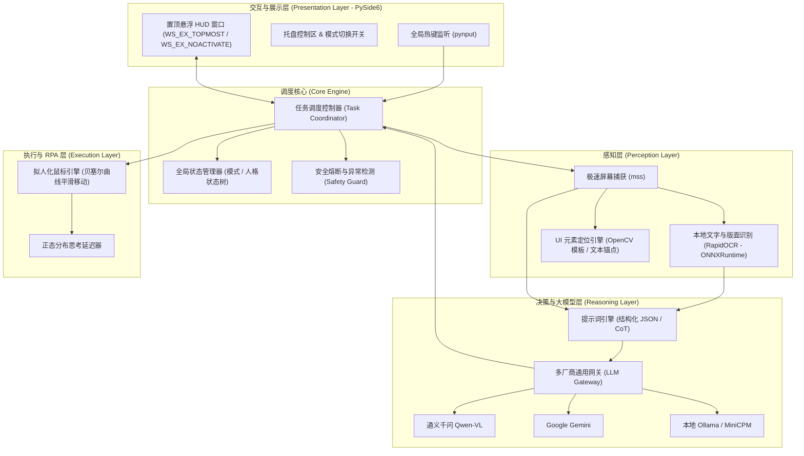

# 校招测评智能辅助系统 (Assessment Copilot) 技术方案与架构设计文档

> **项目声明**：本项目仅用于多模态大语言模型 (VLM)、计算机视觉 (CV/OCR) 及机器人流程自动化 (RPA) 的技术学习与工程实践探索，不得用于违规作弊或商业牟利。

---

## 1. 项目概述与设计目标

### 1.1 项目背景
国内校招及企事业单位笔试中包含大量综合素质测试（认知能力 EPI、言语理解、数理逻辑、资料分析、图形推理）以及职业性格测评（OPQ）。各招聘平台普遍采用防作弊机制（如页面全屏锁定、切屏监控、鼠标动作分析等）。

### 1.2 核心目标
构建一个**跨平台兼容、黑盒非侵入式、高扩展性**的智能辅助答题系统：
1. **非侵入黑盒架构**：不侵入浏览器 DOM，不依赖反作弊专用客户端的内部调试协议，完全基于屏幕图像感知与 OS 级模拟控制。
2. **双模式自如切换**：
   - **安全辅助模式 (Copilot Mode)**：仅做题目分析，在置顶悬浮窗展示答案与思维链，用户自主点击。
   - **全自动循环模式 (Full-Auto Mode)**：自动识别题目、分析作答、拟人化点击选项、自动点击“下一题”推进；**所有题目作答完毕后强制停止，将最终交卷权移交人工**。
3. **多模型厂商无缝热插拔**：基于业界通用的 OpenAI-compatible 规范及适配器工厂模式，支持一键切换通义千问 (Qwen2.5-VL)、Google Gemini、智谱 GLM、DeepSeek 及本地 Ollama。
4. **低资源消耗与高响应速度**：本地轻量级 OCR（RapidOCR）毫秒级完成文字过滤，搭配多模态大模型处理视觉图表。

---

## 2. 核心功能与工作模式设计

### 2.1 模式一：安全辅助模式 (Copilot Mode)
* **适用场景**：高防作弊等级考试、多机位监控、或需要人工把关关键题目的场景。
* **流程机制**：
  1. 用户按下快捷键（默认 `Alt + C`）触发即时分析（或开启定时轮询检测）。
  2. 系统对屏幕区域进行截图并识别。
  3. 悬浮窗半透明置顶展示：
     - **推荐答案**（如：`B`，带有醒目高亮）
     - **置信度**（如：`96%`）
     - **推导过程 (CoT)**：核心逻辑与计算步骤展示。
  4. 窗口保持鼠标穿透与无焦点激活状态，用户手动移动鼠标在原考试界面点击。

### 2.2 模式二：全自动循环模式 (Full-Auto Mode)
* **适用场景**：大量繁琐题目的快速自动化推进。
* **流程机制**：
  1. **自动化做题循环 (Auto Loop)**：
     $$\text{截屏感知} \rightarrow \text{题目与选项识别} \rightarrow \text{LLM 推理决策} \rightarrow \text{定位选项按钮} \rightarrow \text{拟人化点击} \rightarrow \text{定位并点击「下一题」} \rightarrow \text{等待页面加载} \rightarrow \text{下一轮循环}$$
  2. **安全熔断与人工交卷保护机制**：
     - **完题检测 (Termination Detection)**：在每一轮准备点击“下一题”前，检测页面是否存在“下一题”按钮；如果未能检测到“下一题”，但检测到**“提交试卷 / 结束测评 / 答题卡完成”**等关键词时，**系统立刻中断自动循环**。
     - **最终提交权锁定**：系统**绝对不自动点击“确认提交”按钮**，而是通过悬浮窗声光/弹窗提示：“所有题目作答完毕，请人工检查后确认提交！”
     - **全局紧急中断快捷键 (Kill Switch)**：按下 `Esc` 或 `Alt + Shift + X`，立即强行终止后台所有 RPA 点击动作并释放鼠标控制权。

---

## 3. 总体系统架构设计



---

## 4. 关键技术模块详细设计

### 4.1 感知与元素定位层 (Perception & Location)
1. **屏幕捕获**：
   - 采用 `mss` 库直接抓取显存中的桌面位图，单帧耗时稳定在 10~15ms 以内。
   - 支持双屏/多屏识别，支持用户拖拽框选“答题工作区”以过滤无关屏幕杂讯。
2. **OCR 文本与排版提取**：
   - 使用 `rapidocr_onnxruntime`。纯 CPU 推理，模型基于 ONNX 优化，无需庞大的 PyTorch/Paddle 框架依赖。
   - 输出文本内容与每个文字块的精确边界盒 (Bounding Box: `[x_min, y_min, x_max, y_max]`)。
3. **按钮与选项坐标定位 (Click Targeting)**：
   - **文字锚点法 (优先)**：根据 OCR 识别到的 `A.`、`B.`、`C.`、`D.` 或 `下一题` 的边界坐标，直接获取该元素的位置。
   - **区域平移定位**：对于单选圆圈/方框，通常位于选项文字左侧 20~40 像素，结合相对偏移精确定位点击中心。

### 4.2 多厂商通用大模型接入层 (Universal LLM Gateway)

系统采用 **工厂模式 (Factory Pattern)** + **标准协议驱动**，确保可扩展性：

#### 核心类结构设计：
```python
# 核心抽象基类 (Base Provider)
class BaseLLMProvider(ABC):
    @abstractmethod
    async def analyze_question(
        self, 
        image_bytes: Optional[bytes], 
        extracted_text: str, 
        question_type: str
    ) -> QuestionAnalysisResult:
        """接收图像与提取的文本，返回结构化的解析结果"""
        pass
```

#### 统一输出数据协议 (Pydantic Schema)：
```python
class QuestionAnalysisResult(BaseModel):
    selected_option: str          # 推荐选项，如 "A", "B", "C", "D"
    confidence: float             # 置信度 (0.0 - 1.0)
    reasoning: str                # 解题思路与思维链
    is_last_question: bool        # 模型是否判断为最后一题/问卷结束
```

#### 配置文件设计 (`config.yaml`)：
通过配置文件切换模型厂商，无需修改任何业务代码：
```yaml
app:
  mode: "copilot"             # "copilot" (安全辅助) 或 "auto" (全自动)
  hotkey_trigger: "alt+c"     # 手动触发快捷键
  hotkey_stop: "esc"          # 紧急停止快捷键

llm:
  # 当前激活的供应商：可选项为 openai_like, gemini, ollama
  active_provider: "openai_like"

  providers:
    # 通用兼容供应商 (适用于通义千问、DeepSeek、智谱、硅基流动等)
    openai_like:
      base_url: "https://dashscope.aliyuncs.com/compatible-mode/v1"
      api_key: "sk-xxxxxxxxxxxxxxxxxxxxxxxx"
      model: "qwen2.5-vl-72b-instruct"
      temperature: 0.1
      max_tokens: 1024

    # Google Gemini 官方渠道
    gemini:
      api_key: "AIzaSyxxxxxxxxxxxxxxxxx"
      model: "gemini-1.5-flash"
      temperature: 0.1

    # 本地离线私有化部署
    ollama:
      base_url: "http://localhost:11434/v1"
      model: "minicpm-v"

rpa:
  human_delay_min: 3.5        # 模拟答题思考最短延迟 (秒)
  human_delay_max: 7.2        # 模拟答题思考最长延迟 (秒)
  bezier_step_jitter: 1.5     # 鼠标轨迹抖动幅度
```

### 4.3 拟人化执行引擎 (Human-like RPA)

为防止被测评系统（如牛客、赛码）的**鼠标动力学（Mouse Dynamics）行为探针**识别为脚本作弊，执行器执行如下策略：

1. **三阶贝塞尔曲线平滑轨迹 (Cubic Bézier Curve)**：
   - 起点为鼠标当前真实位置，终点为选项按钮的包围盒随机内点（高斯正态分布分布在中心，避免刚好点中几何中心点）。
   - 在路径中引入 2 个随机控制点，生成符合人体工学的平滑加速、减速及小幅度微过冲（Overshoot）。
2. **时序与思考延迟模拟**：
   - 引入正态分布延迟时间（如行测单选通常设定在 $4.0 \sim 8.0$ 秒随机浮动）。
   - 避免恒定作答时间构成的机械周期特征。

### 4.4 悬浮交互层与反焦点检测 (PySide6 HUD)

* **无焦点激活机制**：
  在 Windows 平台下，给悬浮窗设置特定的扩展窗口样式：
  ```python
  # 避免窗口获取焦点触发目标浏览器的 blur / 失去焦点切屏事件
  hwnd = self.winId()
  win32gui.SetWindowLong(
      hwnd, 
      win32con.GWL_EXSTYLE,
      win32gui.GetWindowLong(hwnd, win32con.GWL_EXSTYLE) | 
      win32con.WS_EX_NOACTIVATE | 
      win32con.WS_EX_TOPMOST
  )
  ```
* **状态可视化**：
  - 绿/黄状态指示灯表示当前模式（辅助 / 自动）。
  - 显示当前步骤状态（“正在截屏...”、“模型思考中...”、“已选定 B”、“等待下一题”）。

---

## 5. 项目工程目录规划

```
assessment-copilot/
├── docs/                           # 项目设计与方案文档
│   └── architecture_solution.md    # 核心技术方案规范 (本文档)
├── configs/
│   └── config.example.yaml         # 配置文件模板
├── src/
│   ├── main.py                     # 程序主入口 (GUI 启动与生命周期管理)
│   ├── core/                       # 核心业务调度
│   │   ├── coordinator.py          # 任务调度与工作流引擎 (自动循环/辅助模式)
│   │   ├── safety_guard.py         # 安全守卫 (完题熔断/紧急停止/提交防护)
│   │   └── state.py                # 全局运行时状态管理器
│   ├── perception/                 # 视觉感知与定位
│   │   ├── screen_capture.py       # mss 高性能截屏
│   │   ├── ocr_engine.py           # RapidOCR 引擎封装与版面过滤
│   │   └── ui_locator.py           # 选项与下一题按钮位置判定
│   ├── llm/                        # 大模型推理层
│   │   ├── base.py                 # Provider 抽象基类与 Pydantic 响应模型
│   │   ├── factory.py              # 适配器动态工厂
│   │   ├── prompt_templates.py     # 针对单选/多选/图推的系统 Prompt
│   │   └── providers/
│   │       ├── openai_compatible.py# 通用 OpenAI-compatible 适配器
│   │       ├── gemini_provider.py  # Google Gemini 原生适配器
│   │       └── ollama_provider.py  # 本地 Ollama 适配器
│   ├── rpa/                        # 拟人化执行器
│   │   ├── mouse_driver.py         # 贝塞尔平滑轨迹生成与模拟点击
│   │   └── scheduler.py            # 拟人化思考时间延迟与调度
│   └── ui/                         # 界面交互 (PySide6)
│       ├── overlay_hud.py          # 置顶非激活透明悬浮窗
│       ├── settings_dialog.py      # 模型配置与模式切换面板
│       └── hotkey_manager.py       # pynput 全局热键拦截与分发
├── tests/                          # 单元测试与端到端模拟测试
├── requirements.txt                # 核心依赖清单
└── README.md                       # 项目启动与使用说明
```

---

## 6. 技术实现路线与里程碑

* **阶段 1：感知与推理最小闭环 (Day 1 - 2)**
  * 搭建 `mss` 屏幕截屏与 `RapidOCR` 管道。
  * 封装 `openai_compatible.py` 并接入多模态模型（如通义千问 Qwen2.5-VL / Gemini）。
  * 验证纯文本题与几何图形推理题的识别与做题准确率。
* **阶段 2：PySide6 悬浮 HUD 与辅助模式就绪 (Day 3 - 4)**
  * 开发支持 `WS_EX_NOACTIVATE` 的无焦点置顶窗口。
  * 接入全局热键 `Alt+C`，完成**安全辅助模式 (Copilot Mode)**的完整交付。
* **阶段 3：按钮定位与拟人化 RPA 循环 (Day 5 - 6)**
  * 实现基于 OCR 文本锚点的选项与“下一题”精准坐标计算。
  * 实现三阶贝塞尔鼠标轨迹平滑算法与随机正态思考延迟。
  * 接入完题熔断保护：检测到最后一题时自动停止并移交人工提交。
* **阶段 4：多厂商联调与健壮性打磨 (Day 7)**
  * 完善 `config.yaml` 动态热重载与本地 Ollama 降级机制。
  * 增加全局紧急中断开关 (`Kill Switch`)。
